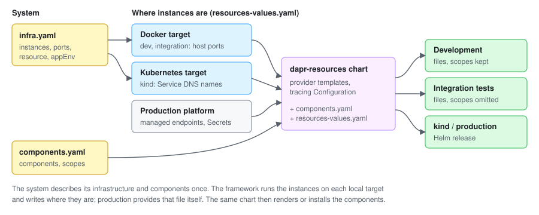
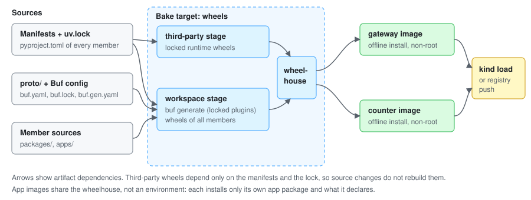

# Architecture

This document explains how the repository is organized, how a request travels between apps, how
apps start, and how the same sources produce local, test and production environments. The
[development guides](development/) explain how to change each part.

## Goals

- **One source per fact.** Messages and validation rules live in Protobuf; Python dependencies
  in package metadata and `uv.lock`; infrastructure instances, components and app instances in
  the environment description; platform tool versions in `deploy/platform/versions.yaml`.
  Everything else consumes or derives from these.
- **The system describes, the framework deploys.** What the system needs (infrastructure,
  components, apps) is data owned by the system; how it is run locally and on Kubernetes is owned
  by the framework and never names a part of the system.
- **Thin apps, reusable packages.** Apps only read settings, wire dependencies and start a server.
  Behaviour lives in packages that are tested without Dapr.
- **Each behaviour is tested where it is owned.** Logic in unit tests, Dapr interaction in
  integration tests, images and Kubernetes behaviour in end-to-end tests.
- **Production-shaped by default.** The same images and charts run in kind and in production; only
  the environment inputs differ.

## Layers and ownership

| Layer | Location | Owner | Knows about |
| --- | --- | --- | --- |
| System code | `proto/<namespace>/`, `packages/<domain>/`, `apps/`, `deploy/docker/<app>/`, `tests/integration/<domain package>/`, `tests/e2e/` | the system | itself |
| Environment description | `deploy/environment/` (infrastructure instances, components), `deploy/apps/` (app instances), the app targets in `docker-bake.hcl` | the system | the system's parts, as data |
| Platform | `deploy/platform/` (charts, kind topology, tool versions), `deploy/docker/wheels.Dockerfile`, `packages/app-runtime` and `tests/integration/app-runtime/`, `proto/platform/` (a contract for the platform's own tests) | the framework | conventions shared by every system (probes, startup checks, tracing configuration) |
| Task engine | `scripts/` | the framework | tools (Dapr CLI, Docker Compose, Helm, kind, Bake) and the shape of the description, never its content |

Dependencies point upwards in this table only. Replacing the example system changes the first two
layers and none of the last two, as long as the system uses the Dapr component types and resource
kinds the platform supports (`state.redis` on a `redis` resource, tracing on an `otlp` resource).
Supporting another type or kind is an extension of the platform (see
[Infrastructure and components](development/components.md#add-a-component)). `scripts/tests/test_layering.py` enforces this for `scripts/`: it
fails when a script imports system code or contains a name or port number defined by the
environment description. `poe lint` checks that the description is consistent (components refer
to provided resources, scopes name existing apps, exposed host ports are unique).

## Workspace

The repository is a [uv workspace](https://docs.astral.sh/uv/concepts/projects/workspaces/) on
Python 3.14 with a single `uv.lock`.

| Member | Kind | Responsibility |
| --- | --- | --- |
| `gen/python` (`contracts`) | generated | Python code generated from `proto/` by Buf. Not committed. |
| `packages/app-runtime` | library | Settings, JSON logging, tracing, validation and error interceptors, Dapr startup checks, app factory, Connect clients through Dapr, serving over gRPC. |
| `packages/greeting` | library | The example domain: `greeting.gateway` (public API) and `greeting.counter` (`CounterService`). |
| `apps/gateway`, `apps/counter`, `apps/counter-grpc` | app | Read settings, wire packages, expose a console script. |

Members declare their own dependencies; being in the workspace does not make one member a
dependency of another. The root project is not a package: it holds development tools and the
`poe` tasks.

Packages are named after a domain (`greeting`), apps after a deployable unit (`gateway`,
`counter`). One app can combine several domain packages, and one package can serve several apps.

## Contracts and code generation

`.proto` files under `proto/<namespace>/<service>/v1/` define messages, RPC methods and
validation rules. Buf generates, from `buf.gen.yaml`:

- [protobuf-py](https://protobufpy.com/) messages (`*_pb.py`), and
- Connect service interfaces, ASGI applications and typed clients (`*_connect.py`).

Both protoc plugins are Python packages pinned in `uv.lock` (`codegen` dependency group) and run
locally; Buf downloads only the `protovalidate` module, pinned in `buf.lock`. Generated code goes to
`gen/python/src/contracts/` and is rebuilt by `uv run poe proto`; the image build generates it too,
so builds never depend on files generated on the host.

Validation rules are written with [Protovalidate](https://protovalidate.com/) annotations:

```proto
string key = 1 [(buf.validate.field).string = {min_len: 1, max_len: 64, pattern: "^[A-Za-z0-9 _-]+$"}];
```

Constructing or parsing a message does not validate it. A server interceptor validates every
unary request and returns `INVALID_ARGUMENT` before the method runs. Generated messages can be
used directly as Pydantic fields when a Python model needs to embed them.

## Calls between apps

Apps call each other with the generated Connect clients through their Dapr sidecars, over one of
two protocols. The caller chooses the protocol with `dapr_client(..., protocol=...)`; the gateway
lets the visitor choose with `POST /greet?protocol=connect|grpc` (default `connect`).

```text
Connect   gateway ──HTTP──▶ sidecar :3500 ══ mTLS/gRPC ══▶ sidecar ──HTTP──▶ counter       (uvicorn, FastAPI)
            POST /v1.0/invoke/counter/method/example.counter.v1.CounterService/Increment
gRPC      gateway ──h2c───▶ sidecar :50001 ═ mTLS/gRPC ══▶ sidecar ──h2c───▶ counter-grpc  (grpcio)
            /example.counter.v1.CounterService/Increment, header dapr-app-id: counter-grpc
```

**Connect** (Dapr service invocation, the default):

- The client's base URL is the local sidecar's service invocation API for the target app
  (`/v1.0/invoke/<app-id>/method`), the same URL the Dapr SDK uses; the client appends the method
  path and sends the Connect protocol (HTTP POST, binary Protobuf body).
- Dapr forwards the request to the target's sidecar and on to the app (`appProtocol: http`). The
  target's HTTP status and Connect error body come back unchanged, so the caller receives a normal
  `ConnectError` (for example `INVALID_ARGUMENT`).
- Unary and streaming calls are plain HTTP, so the server runs on uvicorn inside FastAPI. Through
  Dapr, server streaming, client streaming and half-duplex bidirectional streaming work; full-duplex
  bidirectional streaming does not, because the sidecar returns no response until the request
  stream has ended.

**gRPC** (Dapr gRPC proxying):

- The client sends gRPC over HTTP/2 to the local sidecar's gRPC port, with the target app id in
  the `dapr-app-id` header (added by `dapr_client`). Requests are not compressed: the sidecar
  forwards the original `content-length` of a decompressed request, which the target rejects.
- The target serves the same service implementation with grpcio (`app_runtime.grpc_server`,
  `appProtocol: grpc`): handlers are built from the generated service's descriptor, messages are
  the generated classes, and the same Connect interceptors run around each call. Status codes and
  messages come back unchanged. All stream types work, including full-duplex bidirectional
  streaming.
- A Dapr app has one app port and one protocol, so a service offered over both protocols runs as
  two apps (here `counter` and `counter-grpc`). They share state through the state store's
  `keyPrefix: name`.
- Differences to know: Dapr's documentation states that resiliency policies are not supported for
  gRPC proxying (for streams, at most the initial connection); in standalone mode a call to an
  unknown app id waits for the deadline instead of failing at once; binary (`-bin`) metadata is
  not passed to the service; error details are not sent.

On both paths the sidecar address and API token are read from the Dapr SDK settings, so the
clients and the SDK's `DaprClient` always use the same sidecar and credentials, and Dapr does not
read or validate the Protobuf payload: validation happens in the target app.

The gateway exposes a plain JSON API (`POST /greet`) with FastAPI. Its request model checks only
the shape of the request (422 when the body or `protocol` does not match). The rules for a valid
name are the counter's contract rules; the gateway turns the counter's `INVALID_ARGUMENT` into a
400 response with the violation message, and every other failure into a generic 502/503 response
without internal details.

## App startup

`app_runtime.create_app()` configures JSON logging and OpenTelemetry tracing when it is called,
before the app creates any Connect application or client. It returns a FastAPI app whose lifespan
runs before uvicorn accepts any connection (a gRPC app's `run_grpc()` runs the same steps before
it opens its port):

1. Wait for the sidecar's outbound readiness (`/v1.0/healthz/outbound`), then create the Dapr
   client.
2. Check the app's **required components** through the Dapr Metadata API: name, category (type
   prefix) and capabilities, polling until they are loaded.
3. Let the app attach its resources (clients, stores), then serve.

Steps 1 and 2 share one deadline, `APP_STARTUP_TIMEOUT_SECONDS`. If the sidecar is not ready in
time, startup fails with `SidecarNotReady`; if components are missing, with the list of missing
components. The process then exits with a non-zero code (also with `APP_RELOAD`). `/healthz` and
`/readyz` therefore answer only after the checks passed, and a gRPC app's port opens only then
(its probes check that the port accepts connections); in Kubernetes the Pod never becomes ready
and the restart is visible.

Requirements come from the app's code and settings, for example "the state store named by
`APP_STATESTORE_NAME`, with `ETAG` support". They are never derived from the components an
environment happens to provide, otherwise a missing component would silently disappear from the
check. The gateway has no component requirements; its dependency on the counter is a service
dependency and is handled at request time.

On shutdown the app's resources and the Dapr client are closed in reverse order and pending spans
are flushed; the tracer provider is shared by the process and shut down when it exits.

## State and concurrency

The counter increments with read-modify-write and first-write-wins ETags. A write based on a stale
read fails (`ABORTED`) and is retried with jittered exponential backoff, so concurrent increments
never lose updates. Concurrent first inserts of the same key can be reported by the state store as
a generic save failure; those are retried as well, but a failure that persists after the retries is
returned as a server error instead of being hidden.

Retries respect the caller's deadline, which Connect clients send with every call: when the time
left would not cover another attempt, the counter stops and returns `ABORTED`, which the gateway
reports as 503. An increment is not idempotent, though. If a call times out or the connection
breaks after the write, the caller cannot tell whether the visit was counted, and retrying may count
it twice. Exactly-once counting would need an idempotency key per request; the example does not
implement one.

## Observability

| Signal | Producer | Configuration |
| --- | --- | --- |
| App traces | OpenTelemetry SDK, Connect and FastAPI instrumentation | standard `OTEL_*` environment variables |
| Sidecar traces | Dapr | `spec.tracing` of the Dapr Configuration (`dapr-resources` chart) |
| Logs | stdlib logging as JSON with `trace_id`/`span_id` | `APP_LOG_LEVEL` |

W3C Trace Context propagates through Dapr, so one request produces one trace containing the
gateway app, the gateway sidecar, the counter sidecar and the counter app (or `counter-grpc`).
With gRPC proxying, the target sidecar passes on the `traceparent` it received, so the target
app's span is a child of the caller's sidecar span rather than of its own sidecar's span. Apps and sidecars export
to the same OTLP endpoint in local environments (Jaeger); in production the platform provides the
endpoint. Without an endpoint, apps still propagate context but export nothing.

## Environments

| | Development (`poe dev`) | Integration tests | kind (`poe kind up`, `poe e2e`) | Production |
| --- | --- | --- | --- | --- |
| Apps | native processes, `dapr run` | pytest under `dapr run`, one per package | images in Pods with injected sidecars | same images |
| Dapr control plane | slim runtime, no Placement/Scheduler | same | standard control plane (official chart) | provided by the platform |
| Infrastructure | Docker, instances enabled for `dev` | Docker, instances enabled for `integration`, shared by all tasks of a run | Kubernetes, instances enabled for `kind` | provided by the platform |
| Components | rendered files, with scopes | rendered files, without scopes | Helm release, with scopes | the same chart and components |
| Exposed ports | declared host ports | none | declared host ports (free ports for `e2e`) | the platform's ingress |

Native sidecars run without Placement and Scheduler: `dapr init --slim` installs their binaries
but starts no services, and neither is needed by these apps. Their Dapr HTTP and gRPC APIs listen on 127.0.0.1
only, since they have no authentication; `dapr run` cannot restrict the internal gRPC and metrics
listeners, so keep a host firewall on development machines that share a network. The kind cluster runs the standard Dapr control plane so
that end-to-end tests exercise the same shape as a production cluster.

### Infrastructure instances

`deploy/environment/infra.yaml` describes each instance once: image, ports, readiness command,
mounted files, the environments it runs in, ports exposed to the host, its entry in
`resources-values.yaml` and environment variables it gives to apps. The framework runs it on both
targets from that single description:

- **Docker**: a Compose project generated for the run (`.run/<run-id>/compose.yaml`), with ports
  published on 127.0.0.1 only.
- **Kubernetes**: the generic chart `deploy/platform/charts/infra`, one Deployment and Service per
  instance, NodePorts for exposed ports.

In the `resource` and `appEnv` templates, `{host}` and `{port:<name>}` become the address in each
target: a published host port for Docker, the in-cluster Service name and container port for
Kubernetes. The result is `.run/<run-id>/resources-values.yaml` and the environment of every app.

### Dapr resources



`deploy/platform/charts/dapr-resources` renders Dapr Components and the Configuration from two
inputs:

- **Components** in `deploy/environment/components.yaml`: name, type, version, the infrastructure
  resource they use, scopes and behaviour settings. Scopes follow the system's apps, so this file
  belongs to the system.
- **Where the infrastructure is**, in a `resources-values.yaml`. Local setups generate it;
  production supplies its own (see `deploy/platform/resources-values.example.yaml`).

The chart renders to files for native sidecars and installs as a release in Kubernetes. For
integration tests the scopes are omitted at render time, because each test sidecar has a generated
app id; the source definition is not changed. The Configuration (`app-config`) is a platform
convention: it exports sidecar spans to the `tracing` resource when the environment provides one.

### Apps

`deploy/apps/<deployment>.yaml` describes one app instance: app id, port, protocol, Dapr
Configuration, environment, the image target and the ports exposed to the host. The native
launcher reads it to build `dapr run` arguments; Helm uses it as values for the generic
`deploy/platform/charts/app` chart. Each environment adds its own overrides: the image reference,
the environment variables of the infrastructure, and a NodePort Service for exposed apps.

The protocol (`appProtocol: http` or `grpc`) decides how the framework checks the app: `/readyz`
and `/healthz` for HTTP apps, an open port for gRPC apps (in `poe dev` and in the chart's probes).
Integration test sidecars use the protocol of the member's app, and only HTTP apps restart on code
changes in `poe dev`.

## Images



`docker-bake.hcl` is the only entry point for images:

1. The `wheels` target generates code with Buf, builds wheels of all workspace members and
   downloads the locked third-party runtime wheels. Dependency downloads only depend on the project
   manifests and `uv.lock`, so source changes do not invalidate them.
2. Each app target consumes `wheels` as a build context and installs its package offline. A
   missing wheel fails the build.
3. The final image contains only the virtual environment and runs as a non-root user; the entry
   point is the app's console script.

Images are built for the architecture of the machine that builds them. The kind workflows load them
into the cluster with a unique tag per run, so the cluster never pulls an unexpected image.

## Task engine

`scripts/` implements the `poe` tasks. Entry points and building blocks are kept apart:

```text
scripts/
├── tasks/            one module per task: arguments, sequence, report
└── framework/        building blocks: no argument parsing, no exits
```

| Task module | Command | What it does |
| --- | --- | --- |
| `tasks/dev.py` | `poe dev` | infrastructure for `dev`, rendered Dapr resources, one `dapr run` per app, readiness per protocol, cleanup on exit |
| `tasks/integration.py` | `poe integration` | infrastructure for `integration`, one `dapr run -- pytest` per member (with the protocol of its app), parallel workers, results |
| `tasks/kind.py` | `poe kind up` / `down` | cluster with everything deployed; deleting it with its images |
| `tasks/e2e.py` | `poe e2e` | a fresh cluster, the BDD scenarios, diagnostics, cleanup |
| `tasks/images.py` | `poe images` | Bake builds, optionally multi-platform and pushed |
| `tasks/lint_deploy.py` | part of `poe lint` | consistency of the description, chart and Compose checks |
| `tasks/teardown.py` | `poe teardown` | removes what a run's record lists |
| `tasks/versions.py` | CI only | prints versions from `deploy/platform/versions.yaml` |

| Framework module | Layer | Responsibility |
| --- | --- | --- |
| `repo.py` | 0 | repository paths, project name, workspace members, tool versions |
| `shell.py` | 1 | running commands (Helm isolated from the user's configuration), required tools, free ports, waiting |
| `runs.py` | 2 | run ids and records, interrupts (Ctrl+C, SIGTERM, SIGHUP), process groups |
| `description.py` | 3 | the environment description: apps, infrastructure instances, components, exposure, address templates |
| `images.py` | 3 | Bake builds and image removal |
| `docker.py` | 4 | Docker target: the Compose project of the infrastructure |
| `native.py` | 4 | native sidecars: `dapr run` commands and Dapr resources rendered to files |
| `kubernetes.py` | 4 | Kubernetes target: cluster, Dapr chart, infrastructure chart, Dapr resources, app releases, diagnostics |
| `cleanup.py` | 5 | teardown of a run |

Tasks use framework modules and never each other; a framework module imports lower layers only.
`scripts/tests/test_layering.py` checks both rules, and that no script names a part of the system.

The framework's own tests are in `scripts/tests/` and run with `uv run poe framework-tests` (part
of `poe check`). Unlike the unit tests of the system, they may use local tools: some render the
charts with Helm, others start and stop processes. They use synthetic environment descriptions, so
they keep passing when the example system is replaced.

## Runs and cleanup

Every task that creates resources gets a run id and writes `.run/<run-id>/environment.json`,
recording each container project, process, image and cluster right after it is created. `dev`,
`integration` and `e2e` clean up when they end, including on Ctrl+C, SIGTERM and SIGHUP. `kind up`
keeps what it creates, also when it is interrupted; `kind down` removes the cluster and its images.
`images` builds artifacts and records nothing. Teardown removes only what the record lists, newest
first, and can be repeated; `uv run poe teardown --run-id ID` finishes a cleanup that could not run
(for example after SIGKILL). Logs, reports and diagnostics stay under `.run/<run-id>/`.
